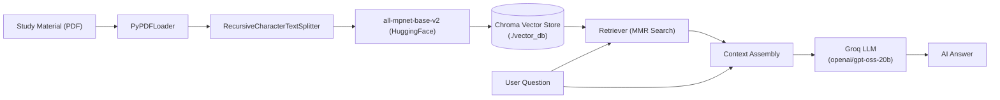

# RAG Study Material Assistant (RAG_Retriever)

A Retrieval-Augmented Generation (RAG) conversational assistant that ingests study material (PDF documents), indexes content into a vector database, and generates grounded, accurate answers to student questions without hallucinating.

---

## 📌 Overview

Studying from extensive PDF textbooks, lecture notes, or research papers often involves searching through dozens or hundreds of pages for specific concepts. This project implements a **Retrieval-Augmented Generation (RAG)** pipeline:

1. **Ingests & Chunks**: Loads study material PDFs and slices them into semantically coherent overlapping chunks.
2. **Embeds & Stores**: Uses high-dimensional sentence transformer embeddings to index text chunks into a persistent Chroma vector database.
3. **Retrieves with MMR**: Performs Maximal Marginal Relevance (MMR) retrieval to extract relevant and diverse context while eliminating redundancy.
4. **Grounded Generation**: Feeds the retrieved passages into an LLM with strict instructions to answer **only** based on the provided material, replying with *"I don't know"* if information is not present.

---

## 🛠️ Architecture & Tech Stack



- **Framework**: [LangChain](https://www.langchain.com/) (LangChain Core, LangChain Community, LangChain Chroma, LangChain HuggingFace)
- **Embeddings**: `sentence-transformers/all-mpnet-base-v2` via HuggingFace
- **Vector Database**: [ChromaDB](https://www.trychroma.com/) (local persistent storage)
- **LLM Provider**: [Groq](https://groq.com/) running `openai/gpt-oss-20b` (fast inference)
- **Document Ingestion**: `PyPDFLoader` & `RecursiveCharacterTextSplitter`

---

## 📂 Project Structure

```text
rag_pro/
├── document_loaders/          # Experimentation scripts & sample PDFs
│   ├── sample_1.pdf           # Sample study material
│   ├── sample.pdf             # Sample reference PDF
│   ├── pdf.py                 # PDF loading demonstration script
│   └── page.py                # WebBaseLoader & prompt experiments
├── vector_db/                 # Persistent Chroma vector store index
├── vector_store/              # Vector database experiments & utilities
│   └── db.py                  # Chroma vector similarity testing
├── ingestion.py               # Ingestion pipeline: loads, splits & embeds PDF
├── main.py                    # Interactive Q&A loop with MMR retrieval & LLM
├── requirements.txt           # Project dependencies
└── README.md                  # Project documentation
```

---

## 🚀 Getting Started

### 1. Prerequisites

- Python 3.10+
- A [Groq API Key](https://console.groq.com/) for LLM inference

### 2. Installation

Clone the repository and set up a virtual environment:

```bash
git clone https://github.com/WorkingOnIT17/RAG_Retriever.git
cd RAG_Retriever

python3 -m venv .venv
source .venv/bin/activate  # On Windows: .venv\Scripts\activate
pip install -r requirements.txt
```

### 3. Environment Setup

Create a `.env` file in the root directory and add your API keys:

```env
GROQ_API_KEY="your-groq-api-key-here"
```

---

## 📖 Usage

### Step 1: Ingest Study Material

1. Open `ingestion.py` and set the path to your study PDF:
   ```python
   # In ingestion.py
   path = "document_loaders/sample_1.pdf"  # Specify your PDF path
   ```
2. Run the ingestion script:
   ```bash
   python ingestion.py
   ```
   This loads the document, chunks it (chunk size: 1000 characters, overlap: 200 characters), computes embeddings, and saves the index to `./vector_db`.

### Step 2: Start Asking Questions

Run the interactive terminal assistant:

```bash
python main.py
```

Example interaction:

```text
RAG created.
Press 0 to exit.
You: What is the main topic covered in section 2?
AI:  The main topic covered in section 2 is...

You: What is the theory of relativity?
AI:  I don't know.
```

*(Notice: The assistant refuses to hallucinate answers not contained in the context!)*

To exit the session, type `0` and press Enter.

---

## ⚙️ Configuration & Key Parameters

- **Chunk Size & Overlap** (`ingestion.py`):
  - `chunk_size=1000`: Slices text into semantic blocks suitable for embedding.
  - `chunk_overlap=200`: Retains cross-boundary context between chunks.
- **Retrieval Strategy** (`main.py`):
  - `search_type="mmr"`: Maximal Marginal Relevance balances relevance with diversity.
  - `k=2`: Top 2 most relevant passages passed to the prompt.
  - `fetch_k=10`: Evaluates 10 candidates before selecting the top 2 diverse chunks.
  - `lambda_mult=0.5`: Balances similarity and diversity (`0` = max diversity, `1` = pure similarity).

---

## 🛡️ License

This project is open-source and available under the [MIT License](LICENSE).
